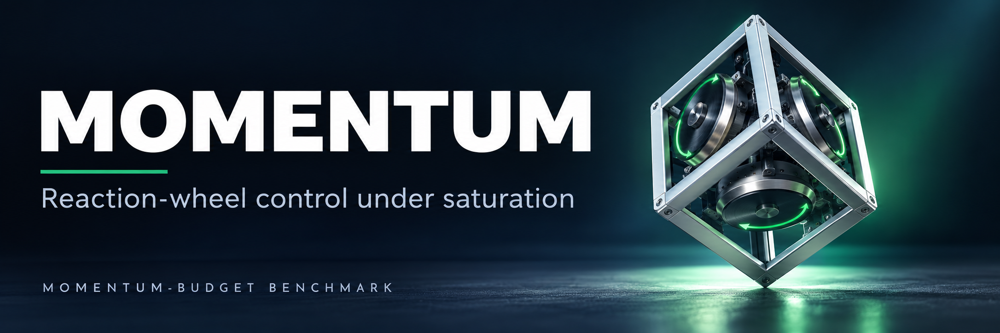
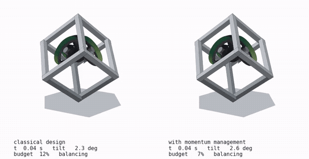

<div align="center">



<br/><br/>

**Gravity-Torque Momentum Management for a<br/>Three-Wheel Reaction-Wheel Inverted Pendulum**

<sub>José Luis Segundo Manayay · Javier Yanpier Garay Yovera · Francisco Jesús Rodríguez Huiman</sub><br/>
<sub>Faculty of Mechanical Engineering · Universidad Nacional de Ingeniería (UNI) · Lima, Peru</sub>

<br/>


[](https://github.com/JoseSegundoM/cubli_momentum_budget/actions/workflows/ci.yml)

</div>

---

> A reaction wheel that holds a body against a persistent torque integrates that torque, so its
> **speed, not its torque, is what runs out**. On a corner-balancing cube the only external torque
> that can unload the wheels is gravity, which also destabilizes the plant. This repository asks
> which control designs keep the cube balanced when wheel speed is the binding limit.

The manuscript is [`paper/paper_final.pdf`](paper/paper_final.pdf) (6 pages) with the supplement
[`paper/supplement.pdf`](paper/supplement.pdf) (2 pages). Every number, Table I, the figures and the
supplement are regenerated by the scripts in this repository from the recorded runs in `results/`.

> [!IMPORTANT]
> **All results are simulation.** The plant is a declared design point, not identified hardware;
> the pivot is ideal and the recovery maps are empirical, not certified regions of attraction.
> The paper was accepted at HRFEST 2026; publication in IEEE Xplore is pending and no DOI exists yet.

<div align="center">

</div>

---

## ✨ Main results

Monte Carlo over 150 perturbed plants with random center-of-mass offsets, 15 s horizon
(Table I of the paper; balanced share with Wilson 95 % interval). `cl.`: classical design;
`MM`: with the gravity-torque momentum manager.

| Controller | Variant | Settling time [s] | Effort | Balanced [%] | 95 % CI |
| --- | --- | --: | --: | --: | :--: |
| LQR (momentum-weighted) | cl. | 0.08 | 0.010 | 99.3 | [96, 100] |
| LQR (momentum-weighted) | MM | 0.08 | 0.010 | 100.0 | [97, 100] |
| Constrained MPC | cl. | 0.08 | 0.015 | 96.7 | [92, 99] |
| FBL+LQR | cl. / MM | 0.06 | 0.102 / 0.105 | 36.0 / 82.0 | [28, 44] / [75, 88] |
| Sliding mode | cl. / MM | 0.06 | 0.100 | 36.0 / 94.0 | [28, 44] / [88, 97] |
| Backstepping | cl. / MM | 0.06 | 0.131 | 34.7 / 85.3 | [27, 43] / [78, 91] |
| PID | cl. / MM | 0.06 | 0.243 / 0.242 | 33.3 / 96.7 | [26, 42] / [92, 99] |

- **Every equilibrium of the disturbed plant holds a gravity-balanced lean** with no momentum
  accumulating in the wheels, so designs that regulate the attitude error to zero have no equilibrium
  to reach. A 2 mm offset needs under 1° of lean, yet it fells FBL, SMC, backstepping and PID.
- **Momentum management restores them.** The gravity-torque augmentation raises the momentum-blind
  designs from 33.3–36.0 % to 82.0–96.7 %. The best is level with the constrained MPC, and none
  outperforms it or the LQR weighted on stored momentum.
- **The binding limit is wheel speed, not torque.** Classical designs fail at η ≈ 0.83, where the
  torque–speed envelope no longer covers bearing friction.

---

## 🏗️ How the study is built

| Layer | Path | Content |
| --- | --- | --- |
| Plant | `cubli/model3d.py`, `params.py`, `actuator.py`, `sim.py` | Nonlinear 3-D model (quaternion attitude, three wheels, pivot friction), declared design point, torque–speed envelope, digital loop with sensor noise |
| Control | `cubli/controllers/` | LQR, FBL+LQR, SMC, backstepping, PID (`ctrl3d.py`), constrained MPC (`mpc.py`, OSQP), swing-up |
| Protocol | `cubli/experiments.py`, `tuning.py`, `stats.py` | Experiment definitions and seeds, one tuning protocol for all designs, Wilson / McNemar / win-ratio statistics |
| Campaigns | `scripts/run_tuning.py`, `scripts/run_experiments.py` | Tuning and Monte-Carlo campaigns that write `results/*.csv` |
| Paper | `scripts/make_numbers.py`, `fig_*.py`, `make_supplement.py`, `paper/` | Numbers, Table I, figures, supplement and the LaTeX source |

---

## 🚀 Quick start

```bash
make setup     # virtual environment and dependencies
make test      # model tests: energy conservation, momentum invariant, linearization
make verify    # regenerate numbers, Table I and the supplement and compare with the committed files
make paper     # both PDF profiles into paper/ (needs TeX Live with IEEEtran, siunitx, TikZ)
```

Run `make help` for every target. Always with `OMP_NUM_THREADS=1 OPENBLAS_NUM_THREADS=1`; the
`Makefile` sets them.

---

## 🔁 Reproducibility

| Paper element | Produced by | Status |
| --- | --- | --- |
| Every number in the text (`paper/numbers.tex`) | `scripts/make_numbers.py` from `results/*.csv` | Regenerated byte for byte |
| Table I (`paper/table_main.tex`) | `scripts/fig_results.py` → `table_main()` | Regenerated byte for byte |
| Supplement (`paper/supplement.tex`) | `scripts/make_supplement.py` | Regenerated byte for byte |
| Fig. 1 schematic and control loop | `scripts/fig_schematic.py`, `paper/fig_control.tex` (TikZ) | Illustration |
| Fig. 2 time series | `scripts/fig_timeseries.py` (re-simulates, seed 3) | Deterministic |
| Figs. 3–4 count matrix and recovery map | `fig_results.py` → `fig_sweeps()`, `fig_roa()` from `E2`, `E3`, `E5` | Regenerated, text identical |
| Monte-Carlo campaigns | `scripts/run_tuning.py`, `scripts/run_experiments.py` | Hours of CPU; a full re-run reproduced all 2400 survival outcomes of `E6` |

Seeds are stored in the `seed` column of every results file. CI runs the tests and checks that the
numbers, Table I and the supplement regenerate unchanged from `results/`.

Data added for the final version: `eta_sweep.json` (standing wheel-speed index against the
center-of-mass offset, nominal plant, 60 s, with and without sensor noise),
`tuned_gains_lexicographic.json` (survival-first re-tuning with `run_tuning.py`, used to check the
tuning cost) and `E6_lexicographic.csv` (the same 150 plants as `E6.csv` with those gains).
`E5_horizon10_ARTIFACT.csv` is kept only to document a horizon artifact; the paper uses `E5.csv`.

---

## 🧪 Limitations

- Simulation only; the testbed is a declared design point, not identified hardware.
- Ideal spherical pivot. A real vertex adds stiction and a drilling torque and can slip; the
  recoveries need a friction coefficient up to about 0.35.
- η ≈ 0.83 depends on the declared, unidentified bearing friction.
- No estimator and no attitude-estimate bias. A disturbance along the balancing axis cannot be
  unloaded by any design here.
- Monte-Carlo survival is censored by the 15 s horizon and depends on the offset distribution;
  recovery maps use one seed per cell.

---

## 🗂️ Repository layout

```
cubli_momentum_budget/
├── assets/            banner
├── cubli/             plant, actuator, simulation loop, controllers, tuning, statistics
├── figures/           paper figures (PDF), previews and the animation
├── paper/             LaTeX source, paper_final.pdf, supplement
├── results/           recorded runs with seeds, tuned gains
├── scripts/           campaigns, numbers, figures, supplement
├── tests/             model tests
└── Makefile           entry point for everything above
```

---

## 👥 Authors

| Author | E-mail | ORCID | GitHub |
| --- | --- | --- | --- |
| José Luis Segundo Manayay (corresponding) | [jose.segundo.m@uni.pe](mailto:jose.segundo.m@uni.pe) | [0009-0002-9203-8710](https://orcid.org/0009-0002-9203-8710) | [@JoseSegundoM](https://github.com/JoseSegundoM) |
| Javier Yanpier Garay Yovera | [javier.garay.y@uni.pe](mailto:javier.garay.y@uni.pe) | [0009-0001-1645-8724](https://orcid.org/0009-0001-1645-8724) | [@garx17](https://github.com/garx17) |
| Francisco Jesús Rodríguez Huiman | [francisco.rodriguez.h@uni.pe](mailto:francisco.rodriguez.h@uni.pe) | [0009-0006-6972-2484](https://orcid.org/0009-0006-6972-2484) | [@frodriguezhuiman-lgtm](https://github.com/frodriguezhuiman-lgtm) |

Faculty of Mechanical Engineering, Universidad Nacional de Ingeniería (UNI), Lima, Peru.

---

## 📄 License

MIT, see [`LICENSE`](LICENSE). Third-party components are listed in [`NOTICE`](NOTICE).

## 📚 Citation

See [`CITATION.cff`](CITATION.cff). Until the proceedings appear, cite the HRFEST 2026 paper by
title and authors; no DOI exists yet.
